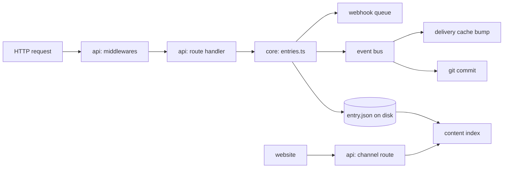

# A request, end to end

This page follows one entry from the moment someone saves it to the moment a website reads it. Every step names the file that does the work, so you can read along. When something in Moteur surprises you, it usually sits on this path.

The two requests:

```http
POST /projects/blog/models/article/entries        (JWT: a signed-in author)
{ "id": "hello", "data": { "title": { "en": "Hello" } } }

GET /projects/blog/channels/site/article/entries  (project API key: a website)
```

Any client sends the first one: the CLI, an MCP agent, a script using [`@moteurio/client`](../../packages/client/README.md), or Studio. The engine treats them all the same way.



## 1. The request enters the API

`packages/api/src/index.ts` builds the Express app. Before any route runs, every request goes through the same chain of middlewares, in this order:

| Middleware               | File                                                 | Job                                                                                                                          |
| ------------------------ | ---------------------------------------------------- | ---------------------------------------------------------------------------------------------------------------------------- |
| Request id               | `middlewares/requestId.ts`                           | Tags the request, so any error logged later can be traced back to it                                                         |
| Security headers, CORS   | `middlewares/security.ts`, `index.ts`                | Browser rules                                                                                                                |
| Classifier               | `middlewares/requestClassifier.ts`                   | Labels the request **studio** (authoring) or **public** (what sites read). Rate limits and usage counts depend on this label |
| Usage, rate limit, quota | `usageLogging.ts`, `rateLimit.ts`, `requestQuota.ts` | Counting and limits per label                                                                                                |

Then `index.ts` mounts the routers. Entries are mounted on their own path (`/projects/:projectId/models/:modelId/entries`) **before** the generic `/projects` router, so they aren't caught by it. Plugins can add routes under `/auth`, `/projects` and `/webhooks`: their routers are merged into the core ones (see [Plugin architecture](../Plugin%20architecture.md)).

## 2. The route checks and validates

`packages/api/src/entries/create.ts` handles the write. A route does four things and no more:

1. **Access:** `requireProjectAccess` (from `middlewares/auth.ts`) checks the JWT and that this person is a member of the project.
2. **Context:** it loads the model schema and the project's languages.
3. **Validation:** `validateEntry` (`packages/core/src/validators/validateEntry.ts`) checks the body against the model. A draft may leave required fields empty; review and publish check them later.
4. **Hand-off:** it calls `createEntry` in core and turns the result, or the error, into an HTTP answer (`utils/apiError.ts`).

Each route file also exports its `openapi` description next to the handler. The OpenAPI document served at `/openapi.json` is built from these, so when you change a route, update its description in the same file.

> **The rule:** routes stay thin. Anything that is a rule of the content (who can publish, what a valid entry is) belongs in `core`, so the CLI, MCP and plugins follow it too.

## 3. Core does the work

`packages/core/src/entries.ts` holds `createEntry`. Read it top to bottom once: most write operations in core follow the same shape.

1. **One writer per project.** `withProjectWriteLock` (`utils/projectWriteLock.ts`) queues writes to the same project, so two saves never interleave. Moteur runs as a single process per data folder (see [Operations](../Operations.md)), which is why an in-memory lock is enough.
2. **Permissions and rules.** `assertCanWrite`, review rules (`needsApproval`), plan limits (`checkCountRoom`). Sending `status: "published"` doesn't skip review: the entry is saved as a draft and then goes through `publishEntry`.
3. **Agent marks.** When the caller is an AI agent (`user.agent`), the fields it wrote are marked as assisted until a person reads them.
4. **`entry.beforeCreate`** event: plugins can still change or refuse the entry.
5. **The write.** `putProjectJson(projectId, entryKey(modelId, id), entry)`.
6. **`content.saved`** event, with the paths written and a commit message.
7. **After the save:** `entry.afterCreate`, a background content scan, and `webhookDispatch('entry.created', …)`. Failures in this last step never fail the save.

## 4. The file on disk

Content is plain JSON files, one folder per project:

```text
<DATA_ROOT>/data/projects/blog/
├── project.json
├── models/article/model.json
├── models/article/entries/hello/entry.json   ← entryKey('article', 'hello')
├── layouts/ pages/ templates/ structures/ …
├── .moteur/      workspace: comments, reviews, activity, caches (not in git)
└── user-data/    visitors' form submissions (not in git)
```

- `utils/storageKeys.ts` is the only place that knows these paths. Always build a path with its helpers (`entryKey`, `modelKey`…), never by hand.
- `utils/projectStorage.ts` reads and writes them. `putProjectJson` writes atomically (temporary file, then rename), so a crash never leaves half a file. It also does two more things on every write:
    - `touchProject` (`deliveryCache.ts`) moves the project to a new version, so answers cached for websites are dropped. Writes under `.moteur/` and `user-data/` are skipped, since sites never see them.
    - `updateContentIndex` updates the index (step 6).
- `config/storageConfig.ts` resolves `DATA_ROOT` and `PROJECTS_DIR`.

## 5. Git keeps the history

Nobody calls git directly when content is saved. `git/contentCommitHook.ts` listens for `content.saved` on the event bus (`utils/eventBus.ts`) and commits the listed paths with the event's message and author. Paths under `.moteur/` and `user-data/` are left out (they are gitignored).

- If a commit fails (disk full, a lock), the paths are remembered and go into the project's next commit. The change is on disk either way.
- During an import (`contentBatch.ts`), commits are held and the whole batch becomes one commit, or none if it's undone.
- Pushing to a remote, branches and snapshots: see [Git](../Git.md).

**Published versions come from git.** When an entry is published, its audit records the commit (`meta.audit.publishedCommit`). If someone edits it afterwards, websites keep getting the published version until it's published again. `contentIndex/publishedView.ts` decides which version a site sees.

## 6. The content index

Files are the source of truth, but scanning thousands of files for every list would be slow. `contentIndex/` keeps a copy for listing, filtering, sorting and paging:

- `sqlite` (the default): one database per project under `.moteur/cache/`, using Node's built-in `node:sqlite`.
- `files`: no index; every query reads every file. Useful for debugging.

The index can always be rebuilt from the files. It re-checks them in the background, every 30 s by default, to catch edits made outside the server. See [Operations](../Operations.md) for rebuilds.

## 7. Webhooks go out

`webhooks/webhookService.ts` → `dispatch` finds the project's enabled webhooks that match the event and their filters, writes a delivery for each and queues it. A worker (`startWebhookWorker`, started in `api/src/index.ts`) sends them, signs them, and retries with backoff. The request doesn't wait for any of this. See [Webhooks](../Webhooks.md).

## 8. A website reads it

The second request goes to `packages/api/src/projects/channels/public.ts`. A **channel** is what a project shows to one site: which models, pages and fields. See [Public API and Channels](../Public%20API%20and%20Channels.md).

1. Authentication accepts a project API key, a preview token or a JWT (`apiKeyAuth`, `previewTokenAuth`, `optionalAuth`).
2. The route finds the channel and the resource. With an API key, it only returns published content, in its **published** version.
3. `queryEntriesForProject` asks the content index, then references are resolved to the depth the channel allows, and `deliverEntry` keeps only the fields the channel exposes.
4. The answer is cached in `deliveryCache.ts` until the project's version changes (step 4).

## Try it

With the API running locally (`pnpm install`, then see the [API README](../../packages/api/README.md)):

1. Create a project and a model, then `POST` an entry, and watch `data/projects/<id>/models/…/entry.json` appear.
2. Run `git log` in the project folder: your save is a commit, with your name on it.
3. Publish it, edit it, and read it through a channel with an API key. You get the published version, not your edit.
4. Put a breakpoint in `createEntry` and run the same request from the CLI. It takes the same path.

The tests are the best map of edge cases: core's are in `packages/core/tests/`, grouped by the same areas as `packages/core/src/` (`entries/`, `git/`, `contentIndex/`…).
