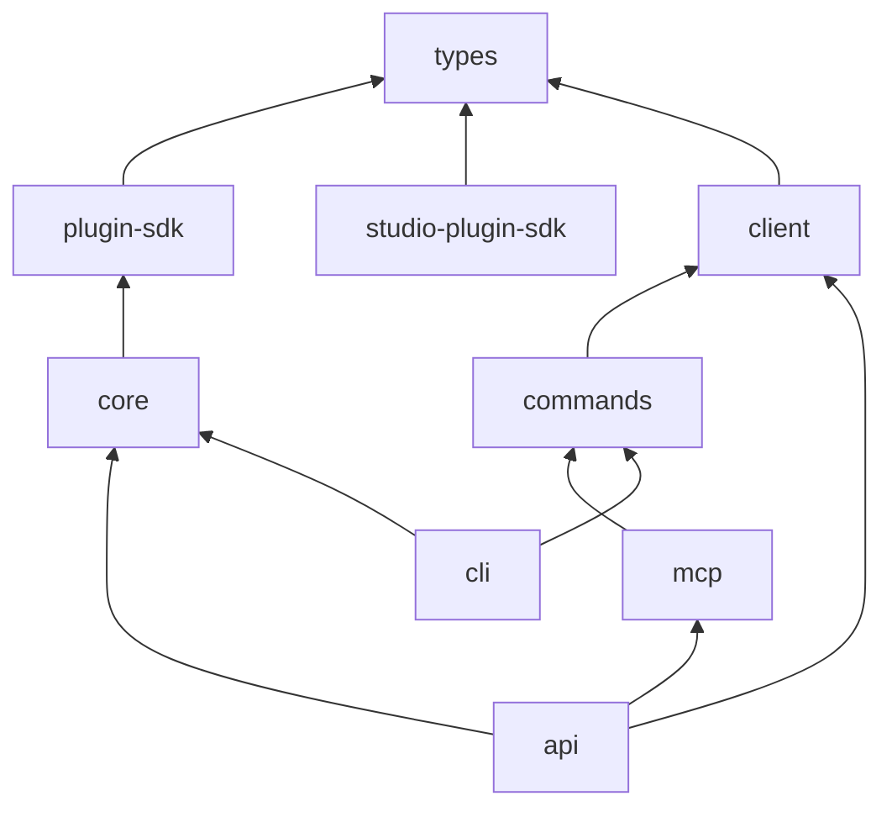

# The map

The engine is a pnpm monorepo: one repository, eleven packages under `packages/`, built and tested together. This page says what each one is for and which way they depend on each other.

## The packages, in layers

An arrow means "depends on". Lower layers never import higher ones: `core` knows nothing about HTTP, and `types` knows nothing at all.

| Package             | Published as                  | What it is                                                                                                                                                         |
| ------------------- | ----------------------------- | ------------------------------------------------------------------------------------------------------------------------------------------------------------------ |
| `types`             | `@moteurio/types`             | The shared TypeScript shapes: projects, models, entries, pages, assets. No code that runs.                                                                         |
| `plugin-sdk`        | `@moteurio/plugin-sdk`        | The contract an engine plugin is written against.                                                                                                                  |
| `studio-plugin-sdk` | `@moteurio/studio-plugin-sdk` | The contract a browser extension is written against (field editors, block previews, setup pages).                                                                  |
| `core`              | `@moteurio/core`              | **The engine itself.** Models, entries, pages, validation, storage, git history, the content index, webhooks, scheduling, plugins. Most of your work happens here. |
| `api`               | `@moteurio/api`               | The Express server. Turns HTTP into calls to `core`, and builds the OpenAPI document.                                                                              |
| `client`            | `@moteurio/client`            | A typed JavaScript client for the HTTP API, for websites and tools. It talks HTTP only; it never imports `core`.                                                   |
| `commands`          | `@moteurio/commands`          | Every API operation declared once as a command: its arguments, its call.                                                                                           |
| `cli`               | `@moteurio/cli`               | The `moteur` command line, built on `commands`.                                                                                                                    |
| `mcp`               | `@moteurio/mcp`               | An MCP server for AI agents, also built on `commands`.                                                                                                             |
| `demo`              | (private)                     | Generates the demo projects: the showcase, edge-case fixtures, and a large project for load.                                                                       |
| `api-docs`          | (private)                     | The static page that shows the API reference online.                                                                                                               |

Two packages deserve a word:

- **`core` is used two ways.** The API server calls it in-process, and so can tools and tests ([Embedded core API](../Developer%20API.md)). That's why rules live in `core`, not in routes: everyone who calls it gets them.
- **`commands` keeps three surfaces in step.** One declaration gives a CLI command, an MCP tool and a line in the [CLI reference](../CLI.md). `pnpm coverage` in `packages/commands` fails when an API operation has no command and no stated reason to skip it.

## Inside `core`

`packages/core/src/` has about ninety files and folders. You don't need them all at once; these are the ones to know first:

| Where                                                 | What                                                                              |
| ----------------------------------------------------- | --------------------------------------------------------------------------------- |
| `entries.ts`, `pages.ts`, `models.ts`, `projects.ts`… | One file per kind of content, holding its create/read/update/delete and its rules |
| `fields/`, `validators/`                              | Field types and the checks on values                                              |
| `utils/storageKeys.ts`, `utils/projectStorage.ts`     | Where files live on disk, and reading and writing them                            |
| `utils/eventBus.ts`                                   | Events like `content.saved`, which the rest of the engine listens to              |
| `git/`                                                | History: commits, branches, pushes                                                |
| `contentIndex/`                                       | The rebuildable index used for listing and for published versions                 |
| `webhooks/`                                           | Outgoing webhooks and their delivery queue                                        |
| `deliveryCache.ts`                                    | Cached answers for websites                                                       |
| `plugins/`, `services/PluginManager.ts`               | Loading plugins and collecting what they add                                      |
| `config/`                                             | Where data lives (`DATA_ROOT`, `PROJECTS_DIR`)                                    |

[A request, end to end](A%20request,%20end%20to%20end.md) shows how these fit together on a real save.

## Inside `api`

`packages/api/src/` is organised like the URL space: `projects/`, `entries/`, `models/`, `auth/`, `webhooks/`… Each route file holds its handler **and** its OpenAPI description. `middlewares/` holds what runs before every route (auth, request ids, limits). `index.ts` puts it all together.

## Around the engine

Other repositories build on the engine through its public API and SDKs:

- **Plugins** add storage, sign-in providers, presence, AI and more: see the [host plugin guide](https://github.com/moteurio/moteur-plugins/blob/main/docs/Plugins.md).
- **Starters** are websites that read a project through a channel: see [Starters](../Starters.md).
- **Moteur Studio**, the web app, is a client of the API like any other. It is a separate product and isn't covered here.
