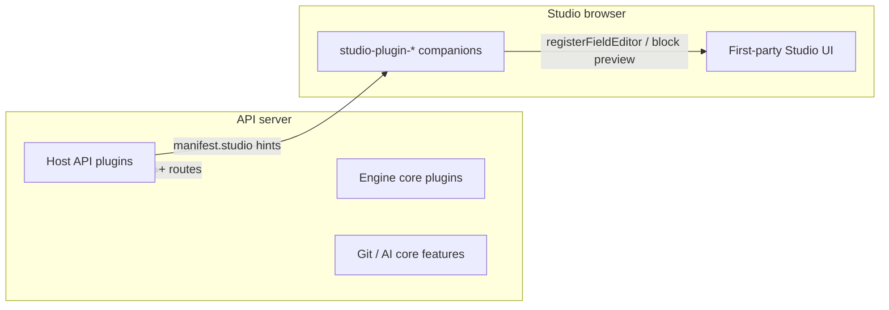

# Plugin architecture

Moteur splits extensibility into a few **layers** and **enablement gates**. This document is the canonical taxonomy; [Plugins.md](Plugins.md) covers host env vars and the plugin contract.

---

## Layers (where code runs)

| Layer                           | What it is                                                   | Loaded how                                                | Typical packages                                                                                          |
| ------------------------------- | ------------------------------------------------------------ | --------------------------------------------------------- | --------------------------------------------------------------------------------------------------------- |
| **Engine core**                 | Always-on behavior inside `@moteurio/core` / `@moteurio/api` | `registerCorePlugins()` at bootstrap                      | Activity log, audit, validation, auto-assign-user                                                         |
| **Core features (not plugins)** | Product features with their own project flags                | Always in the API; toggled per project                    | **Git** (`project.git`), **AI** (`project.ai` + `/ai` routes)                                             |
| **Host API plugin**             | Optional Node module on the API server                       | `MOTEUR_HOST_PLUGINS` → `init` / `getRoutes` / …          | `@moteurio/plugin-*` in **moteur-plugins** or **moteur-plugins-extra**                                    |
| **Studio companion**            | Browser UI for editors (field editors, block previews, nav)  | **Composed at Studio build time** (not loaded by the API) | `@moteurio/studio-plugin-*` in **moteur-plugins-extra** + **`@moteurio/studio-plugin-sdk`** in **moteur** |
| **First-party Studio**          | Private app code beside companions                           | Part of `@moteurio/studio`                                | Billing screens calling `plugin-billing` routes                                                           |

There is **no** supported “Studio-only API plugin”: Studio needs schemas and (usually) HTTP from a **host API plugin**. Companions are optional sugar on top.

---

## Enablement (who turns what on)

Three independent gates apply to **host API plugins**. All must pass for a project-scoped plugin to affect a given project.

| Gate                      | Controls                                                                     | Applies to                                        |
| ------------------------- | ---------------------------------------------------------------------------- | ------------------------------------------------- |
| **Host load list**        | `MOTEUR_HOST_PLUGINS` — module is imported at all                            | Host plugins only                                 |
| **Host allowlist**        | `MOTEUR_ENABLED_PLUGINS` when set — only listed **ids** register             | Host plugins only                                 |
| **Operator choice**       | `data/operator/plugins.json` — on/off for next restart                       | Host plugins (`kind: host` in catalog)            |
| **Project allowlist**     | `project.plugins` when set — only listed **ids** for that project            | Plugins with **`scope: "project"`**               |
| **Project feature flags** | e.g. `project.presence.enabled`, `project.git.enabled`, `project.ai.enabled` | Presence plugin, git, AI (not generic plugin ids) |

Rules:

- **`scope: "global"`** — Host and operator gates still apply; **`project.plugins` does not** hide the plugin. Use for auth, billing, inbound webhooks, AI provider wiring, presence, etc.
- **`scope: "project"`** (default for most play/content plugins) — Also call **`ctx.isPluginEnabledForProject(projectId, id)`** in routes and play handlers when `project.plugins` is used.
- **`project.plugins` unset** — Every **server-enabled** project-scoped plugin applies to every project.

**Studio companions** are not enabled via env on the API. The Studio host lists modules in `studioPlugins/config.ts`. Block previews can be gated with the same plugin **id** and `project.plugins` when the host maps block types to plugin ids.

---

## Manifest fields (`PluginManifest`)

| Field              | Meaning                                                                                                                                                                                                                                                                                  |
| ------------------ | ---------------------------------------------------------------------------------------------------------------------------------------------------------------------------------------------------------------------------------------------------------------------------------------- |
| **`id`**           | Stable id (e.g. `qr`, `storage-s3`). Same id in API manifest, operator UI, `project.plugins`, and Studio companion `manifest.id`.                                                                                                                                                        |
| **`scope`**        | **`global`** \| **`project`** — see enablement above.                                                                                                                                                                                                                                    |
| **`kind`**         | **`core`** \| **`optional`** \| **`project`** — **documentation / catalog hint only** for host packages. Engine built-ins use **`core`**. Host plugins usually set **`optional`**. Do not confuse with catalog **`kind: 'core' \| 'host'`** in the operator API (engine vs host-loaded). |
| **`source`**       | `opensource`, `private`, `npm`, etc.                                                                                                                                                                                                                                                     |
| **`capabilities`** | Optional tags: `routes`, `openapi`, `auth-provider`.                                                                                                                                                                                                                                     |
| **`studio`**       | **Metadata only** — `companionPackage`, `fieldTypes`, `blockTypes`, optional route hints for Studio builds. No React on the API.                                                                                                                                                         |

---

## What a host plugin can contribute

Use **`init(ctx)`** for registration; optional exports for HTTP and server hooks.

| Contribution         | Export / API                                                                 | Example                                          |
| -------------------- | ---------------------------------------------------------------------------- | ------------------------------------------------ |
| **Schemas only**     | `init`: `registerBlockSchema`, `registerFieldSchema`, `registerBlueprint`, … | `geo`, `media-lottie-rive` (no play routes)      |
| **HTTP + OpenAPI**   | `getRoutes(ctx)` → `{ path, router, openapi? }`                              | `qr`, `poll`, `oembed`, `search-*`               |
| **OAuth / login**    | `getAuthProviders()`                                                         | `auth-github`, `auth-oidc`                       |
| **HTTP server hook** | `attachServer(httpServer, app)`                                              | `presence` (Socket.IO)                           |
| **Storage adapter**  | `init`: `registerStorageAdapterFactory`                                      | `storage-s3`, `storage-cloudinary`               |
| **Video provider**   | `init`: `registerVideoProviderFactory`                                       | `video-mux`, `video-youtube`                     |
| **AI provider**      | `init`: registers with `@moteurio/plugin-ai` (`registerAIProvider`)          | `ai-provider-openai` (often **`scope: global`**) |
| **Studio hints**     | `manifest.studio`                                                            | Points at `@moteurio/studio-plugin-qr`           |

A single package may combine several rows (e.g. poll: schemas + routes + Studio companion).

---

## Plugin classes (recommended mental model)

| Class                      | `scope`   | Routes? | Studio companion? | Examples                                                                    |
| -------------------------- | --------- | ------- | ----------------- | --------------------------------------------------------------------------- |
| **Platform**               | `global`  | Often   | Rare              | `auth-*`, `billing`, `webhook-*`, `ai-provider-*`, `presence`               |
| **Project infrastructure** | `project` | Often   | Sometimes         | `storage-*`, `video-*`, `search-*`, `shopify`                               |
| **Content / play**         | `project` | Often   | Often             | `qr`, `poll`, `oembed`, `3d-viewer`, `media-lottie-rive`, `geo`             |
| **Catalog extension**      | `project` | No      | Optional          | `core-blocks`, `core-blueprints`                                            |
| **Studio UI only**         | —         | —       | Built into Studio | Billing pages, core field widgets — **not** a separate `@moteurio/plugin-*` |

---

## Repositories and distribution

| Repo                     | Packages                                                                          | Published how                         | Consumed by                                    |
| ------------------------ | --------------------------------------------------------------------------------- | ------------------------------------- | ---------------------------------------------- |
| **moteur**               | Engine, `@moteurio/plugin-sdk`, `@moteurio/studio-plugin-sdk`                     | npm (calendar line)                   | Everyone                                       |
| **moteur-plugins**       | Public `@moteurio/plugin-*`                                                       | npm                                   | Self-hosted API, listed in host env            |
| **moteur-plugins-extra** | Private `@moteurio/plugin-*` (incl. **`plugin-ai`**), `@moteurio/studio-plugin-*` | GitHub Release **tarballs** (not npm) | **api.moteur.io**, **studio.moteur.io** builds |
| **moteur-studio**        | `@moteurio/studio`                                                                | Private dist tarball                  | Hosted Studio                                  |

---

## Checklist for a new feature

1. **Need server behavior?** → Host API plugin (`manifest`, `init`, optional `getRoutes`).
2. **Per-project optional?** → `scope: "project"` + `isPluginEnabledForProject` in handlers.
3. **Host-wide?** → `scope: "global"` (auth, webhooks, billing, …).
4. **Custom Studio editors/previews?** → `manifest.studio` + companion in **moteur-plugins-extra** + entry in Studio `config.ts`.
5. **OpenAPI** → merge paths in `getRoutes`; host export ([docs.api.moteur.io](https://docs.api.moteur.io)) reflects loaded plugins.

---

## See also

- [Plugins.md](Plugins.md) — bootstrap, env vars, contract table
- [Configuration.md](Configuration.md) — `MOTEUR_HOST_PLUGINS`, `MOTEUR_ENABLED_PLUGINS`
- [`@moteurio/plugin-sdk`](../packages/plugin-sdk/README.md)
- [`@moteurio/studio-plugin-sdk`](../packages/studio-plugin-sdk/README.md)
